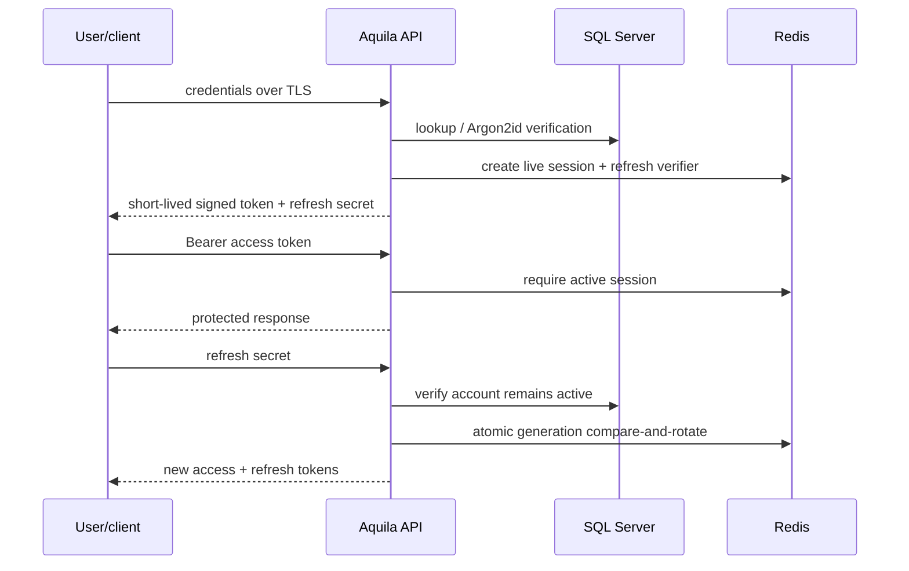
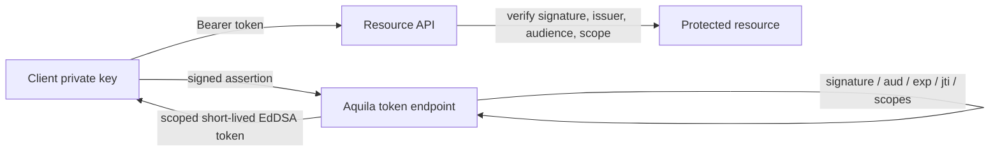

# Aquila — secure TypeScript API foundation

Aquila is a security baseline, not a claim that software can be invulnerable. It demonstrates short-lived signed access tokens, rotating refresh tokens, revocation, role checks, and service authentication. Use a vetted OpenID Connect provider for production user sign-in, MFA, recovery, and federation; the password endpoint is a local example flow.

## Run locally

Requirements: Node.js 22+, Docker, OpenSSL.

```sh
cp .env.example .env
npm install
npm run keys:dev
npm run keys:m2m
docker compose up -d
```

Apply `sql/schema.sql` to SQL Server (commands below), then seed the local administrator:

```sh
docker compose exec -T sqlserver /opt/mssql-tools18/bin/sqlcmd -C -S localhost -U sa -P 'ChangeThis_Local_Only!42' -i /dev/stdin < sql/schema.sql
DEMO_EMAIL=admin@aquila.local DEMO_PASSWORD='AquilaDemo!2026' npm run db:seed:demo
npm run dev
```

Local demo credentials: `admin@aquila.local` / `AquilaDemo!2026`. The seeder leaves an existing account unchanged. Open interactive API docs at [http://localhost:3000/docs](http://localhost:3000/docs), or fetch the OpenAPI JSON at `/docs/json`. Protected examples: `/v1/me`, `/v1/admin`. Never deploy the local keys or example SQL password.

The example Compose file has separate Redis services for sessions (6381) and rate limits (6380), SQL Server on 1434, and NATS JetStream on 4222. Set `REDIS_URL`, `RATE_LIMIT_REDIS_URL`, and `SQLSERVER_PORT` to those ports when running the API on the host. Aquila creates its session-event stream on startup. The local NATS configuration gives Aquila and the consumer separate credentials and subject permissions. Production should provision a replicated stream, TLS, and externally managed credentials.

Managed Redis Cluster startup nodes can be supplied as comma-separated `host:port` pairs with `REDIS_CLUSTER_NODES` and `RATE_LIMIT_REDIS_CLUSTER_NODES`. When set, each replaces its corresponding URL connection. Use a `rediss://` URL to enable TLS.

For browser clients set `BROWSER_COOKIE_AUTH=true`, configure `PUBLIC_ORIGIN`, and serve only over HTTPS. Cookie mode uses an HttpOnly, Secure, Strict SameSite refresh cookie and checks the Origin on login/refresh/logout. Keep access tokens in memory; never store credentials in local/session storage. The JSON refresh response is intended for non-browser clients.

## Security model

- **Ed25519 / EdDSA JWT:** private key signs a five-minute token; public key verifies it. The API pins algorithm, issuer, audience, and expiry. `kid` enables planned key rotation; production should publish a JWKS and keep keys in KMS/HSM or a secrets manager.
- **Refresh token:** EdDSA-signed JWT with a distinct token type, random 256-bit `jti`, session ID, and generation. Redis stores only the current `jti` hash. Refresh compares and rotates atomically; replay of any valid older generation revokes the session. Invalid or tampered JWTs do not revoke sessions. Idle expiry is 14 days and the absolute session lifetime is 30 days. Retrying a refresh after losing its successful response may require sign-in again.
- **Redis sessions:** the authoritative live-session allowlist, current refresh verifier/generation, and M2M assertion replay keys. Missing session state is denied; Redis outage fails protected requests closed with 503. Redis has no SQL fallback.
- **Consumer authorization:** login/refresh publish an active-session event containing the digest of the issued access token. Aquila returns that token only after the consumer applies the event. Logout and early invalidation publish `SessionRevoked`; Aquila waits for the applied acknowledgement before deleting its Redis session and returning 204. The consumer verifies the token locally and checks its own session/token projection; it never calls this API on protected requests.
- **Rate limits:** shared across replicas in a separate Redis deployment/memory budget in production. Local development can share Redis if no second endpoint is configured.
- **SQL Server:** durable user/account records only. Resource APIs do not open SQL connections. Use TLS, least privilege, and migrations. `sql/migrations/001_remove_legacy_sql_sessions.sql` drops old session tables; it was manually applied to the local database and is not run automatically.
- **Authorization:** authentication proves identity; route policy checks role or scope. Missing identity returns 401; insufficient permission returns 403.
- **M2M:** one pre-registered client's public key verifies a signed `private_key_jwt` assertion. The API enforces audience, short expiry, single-use `jti`, and configured scopes, then returns a short-lived scoped access token. Configure `M2M_CLIENT_ID`, `M2M_CLIENT_PUBLIC_KEY_PATH`, and `M2M_ALLOWED_SCOPES`; `npm run keys:m2m` creates a local client key pair. Production needs a managed registry and key rotation.

See [the code organization](docs/code-architecture.md) for folder ownership and dependency wiring, and [the scaling architecture](docs/scaling-architecture.md) for auth/resource deployments, Redis recovery, capacity planning, and the request work each route performs.

For a Portuguese walkthrough of every authentication and authorization flow, see [Fluxos da API](docs/fluxos-da-api.pt-BR.md).

To obtain a token for Aquila Consumer, send `"audience":"aquila-consumer"` in the login or refresh JSON body. Aquila's own resource routes continue to require `aquila-api`. The allowed access audiences are configured by `JWT_ACCESS_AUDIENCES`; clients cannot request arbitrary audiences.

## Diagrams





```text
HTTP routes -> controllers -> application services -> ports
                                              |-> SQL Server: durable users
                                              |-> Redis: live sessions / rate limits / replay cache
```

## Before production

Terminate TLS at a trusted proxy; set `TRUST_PROXY=true` only behind it. Use OIDC and MFA, rate and risk controls, CSRF protections for cookies, strict CORS, secret-managed keys, public-key rotation, audit logs without secrets, encrypted backups, network segmentation, monitoring, and a deployment threat model. Consider sender-constrained access tokens (mTLS/DPoP) for high-risk clients.
