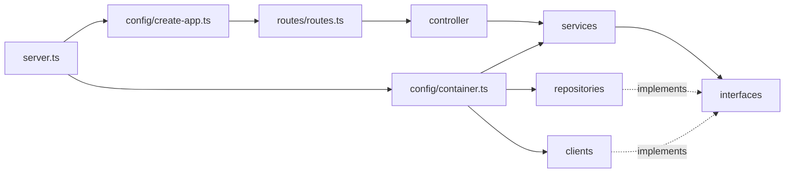

# Code organization

Aquila follows the layer-first layout of `asa.canaisdigitais.asa-api`: routes, controllers, services, interfaces, models, middleware, and configuration are easy to find at the top of `src`. Identity and M2M have small subfolders where a layer contains multiple files. Aquila also has explicit repositories and clients so SQL, Redis, and NATS ownership remains visible.

```text
src/
  server.ts              start and stop the process
  config/                environment, Fastify setup, dependency containers
  routes/                route entry point and endpoint definitions
  controller/            HTTP input and output
  middleware/            user authentication and distributed rate limits
  services/              login, refresh, logout, token and M2M behavior
  interfaces/            I-prefixed service and repository contracts
  models/                user and session data shapes
  repositories/          SQL users and Redis session/replay state
  clients/               Redis connection and NATS event publisher
  utils/                 shared command gate and errors
```



`routes/routes.ts` assembles the route surface and binds controller methods. Controllers translate HTTP requests; services perform operations; repository and client adapters implement the interfaces. The containers assemble dependencies for `all`, `auth`, and `resource` runtime roles. The runtime roles, Redis session authority, and NATS consumer acknowledgement contract are described in [scaling architecture](scaling-architecture.md).

For sequence diagrams and component rationale in Portuguese, see [Fluxos da API](fluxos-da-api.pt-BR.md).
