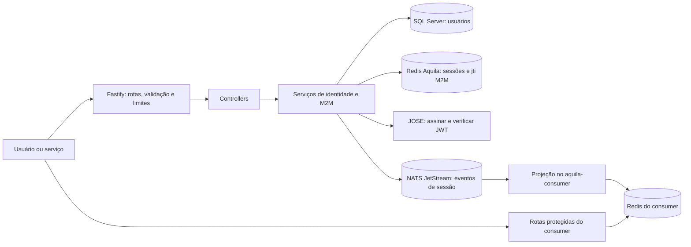
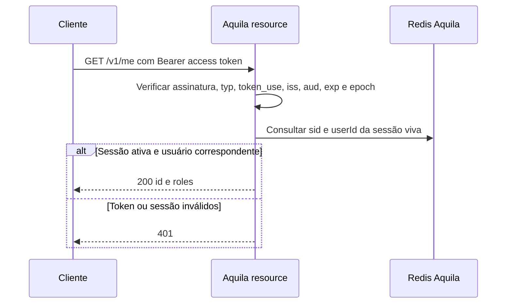
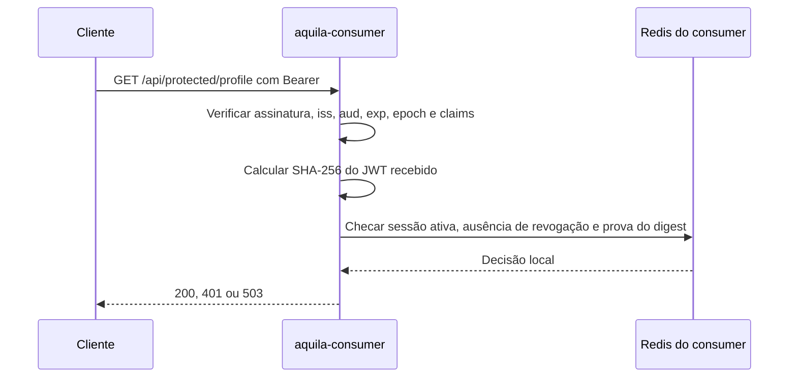
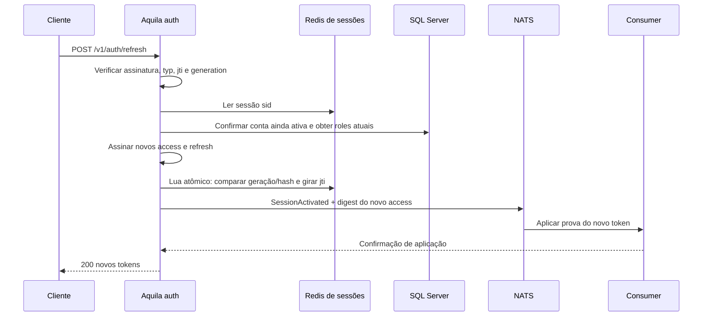
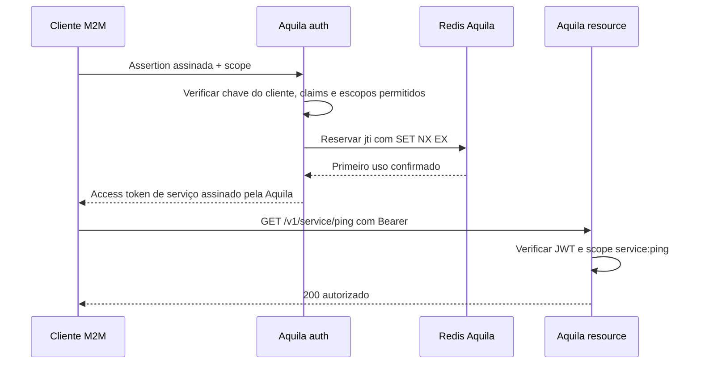

# Aquila: fluxos de autenticação e autorização

Este guia descreve **o comportamento implementado** pela API Aquila e a integração com o projeto `aquila-consumer`. O código organiza a entrada HTTP em [rotas](../src/routes/routes.ts), [controllers](../src/controller), [serviços](../src/services), [interfaces](../src/interfaces) e adaptadores de [repositório](../src/repositories) e [cliente](../src/clients).

## 1. Mapa do sistema



| Componente                   | O que faz                                                            | Por que existe                                                                                                                                                            |
| ---------------------------- | -------------------------------------------------------------------- | ------------------------------------------------------------------------------------------------------------------------------------------------------------------------- |
| Fastify, rotas e controllers | Recebem pedidos, validam formato e devolvem respostas HTTP.          | Mantêm o contrato HTTP fora das regras de autenticação.                                                                                                                   |
| Zod                          | Valida os corpos de login, refresh e M2M.                            | Recusa dados malformados antes de executar operações sensíveis.                                                                                                           |
| SQL Server + Argon2id        | Guardam usuários duráveis e verificam senhas.                        | A conta persiste entre sessões; o hash de senha tem custo deliberadamente alto. Um hash fictício é verificado quando o e-mail não existe para reduzir diferença de tempo. |
| Redis de sessões             | Guarda a sessão ativa, o hash do `jti` atual e a geração do refresh. | Consulta rápida por requisição e revogação imediata; uma sessão ausente nunca é reconstruída do SQL.                                                                      |
| Redis de limites             | Guarda contadores de rate limit.                                     | Isola tráfego abusivo da memória necessária para sessões.                                                                                                                 |
| JOSE + par Ed25519           | Assinam JWTs com chave privada e verificam com chave pública.        | Serviços de recurso verificam a assinatura localmente sem receber a chave privada. `kid` identifica a chave durante rotação.                                              |
| NATS JetStream               | Registra ativações e revogações de sessão.                           | Permite que o consumer mantenha uma projeção própria e recupere eventos após reinício.                                                                                    |
| Redis do consumer            | Guarda provas de tokens emitidos, sessões projetadas e revogações.   | O consumer decide localmente, sem chamada HTTP à Aquila em cada pedido.                                                                                                   |
| Interfaces e containers      | Ligam serviços a repositórios e clientes na inicialização.           | Facilitam troca de adaptadores e separam `auth` de `resource`.                                                                                                            |
| `RedisCommandGate`           | Limita concorrência e abre um circuito breve após falhas de Redis.   | Evita filas sem limite; uma falha de armazenamento retorna 503, sem liberar acesso.                                                                                       |

**Onde cada dado vive:** `dbo.Users` no SQL Server; sessões e `jti` M2M no Redis da Aquila; contadores em outro Redis; eventos no JetStream; projeção e sessões anônimas no Redis do consumer. A Aquila não possui tabela SQL de sessões.

## 2. Inicialização e superfície HTTP

`server.ts` carrega [configuração](../src/config/app.config.ts), cria os clientes e serviços em [container.ts](../src/config/container.ts), inicia o Fastify e registra as rotas. As chaves públicas são carregadas na inicialização; a chave privada só é carregada em papéis que emitem tokens.

| `API_ROLE` | Rotas de usuário                             | Rota M2M               | Dependências principais                |
| ---------- | -------------------------------------------- | ---------------------- | -------------------------------------- |
| `auth`     | `POST /v1/auth/login`, `/refresh`, `/logout` | `POST /v1/m2m/token`   | SQL, Redis, NATS e chave privada.      |
| `resource` | `GET /v1/me`, `/v1/admin`                    | `GET /v1/service/ping` | Redis e chaves públicas; não abre SQL. |
| `all`      | Todas as anteriores                          | Ambas                  | Modo de desenvolvimento local.         |

Todos os papéis expõem `GET /health/live`, `GET /health/ready`, a interface `/docs` e o OpenAPI em `/docs/json`. `live` apenas confirma que o processo responde; `ready` consulta os dois Redis e, no papel `auth`, também SQL e NATS. O readiness da Aquila **não substitui** o readiness da projeção do consumer.

## 3. Login: `POST /v1/auth/login`

Entrada: `email`, `password` e `audience` opcional. A audiência precisa estar em `JWT_ACCESS_AUDIENCES`; para o consumer, use `aquila-consumer`.

```mermaid
sequenceDiagram
  participant U as Cliente
  participant A as Aquila auth
  participant SQL as SQL Server
  participant R as Redis de sessões
  participant N as NATS JetStream
  participant C as Consumer + Redis próprio
  U->>A: POST /v1/auth/login
  A->>SQL: Buscar usuário por e-mail
  A->>A: Argon2id; criar sid e jti; assinar access e refresh
  A->>R: Criar sessão com hash do jti e TTL
  A->>N: SessionActivated + SHA-256 do access token
  N->>C: Aplicar sessão e prova do token
  C-->>A: Confirmação de aplicação
  A-->>U: 200 accessToken + refreshToken
```

- **Por que SQL:** autentica a conta durável; não atende os pedidos protegidos comuns.
- **Por que Redis:** associa `sid` à sessão viva e guarda somente o hash do `jti`, nunca o refresh token bruto.
- **Por que esperar o consumer:** o access token só é entregue depois de sua prova exata existir na projeção. Se NATS ou a projeção falhar, a API retorna 503; não entrega um token que o consumer ainda não pode autorizar.
- Se a sessão já foi criada no Redis e a publicação falha, ela pode permanecer até o TTL sem que o token tenha sido entregue; não haverá prova correspondente no consumer.
- **Limites:** o login tem até 8 tentativas por 15 minutos; há também um limite global de 120 pedidos por minuto.

O access token dura até `ACCESS_TOKEN_TTL_SECONDS` (padrão: 300 s) e nunca ultrapassa a expiração da sessão. O refresh tem expiração por inatividade (padrão: 14 dias) e limite absoluto da sessão (padrão: 30 dias).

## 4. Tokens: o que cada um prova

| Token              | Conteúdo relevante                                                                                                                 | Verificação e uso                                                                                                                                  |
| ------------------ | ---------------------------------------------------------------------------------------------------------------------------------- | -------------------------------------------------------------------------------------------------------------------------------------------------- |
| Access de usuário  | Assinatura EdDSA, `iss`, `aud`, `sub`, `sid`, `roles`, `jti`, `iat`, `exp`, `session_epoch`, `token_use=access`, `typ=JWT`, `kid`. | Identifica usuário e papéis; a sessão ainda precisa estar ativa. Para o consumer, o SHA-256 do **token exato** também precisa constar da projeção. |
| Refresh de usuário | Assinatura EdDSA, `typ=aquila-refresh+jwt`, `token_use=refresh`, `sid`, `generation`, `jti`, `absolute_exp`, `exp`.                | Só entra em `/v1/auth/refresh`; não autoriza recursos. A geração e o hash do `jti` são comparados atomicamente com Redis.                          |
| Access de serviço  | Assinatura EdDSA, `client_id`, `scope`, `token_use=service`, `sub`, `aud`, `exp`, `kid`.                                           | Autoriza rotas M2M pela assinatura e pelo escopo; não representa usuário nem sessão de usuário.                                                    |

`iss` e `aud` são condições necessárias, mas não bastam: sem assinatura de uma chave pública confiável, o token é recusado. No consumer, mesmo uma cópia do modelo de token e dos valores de `iss`/`aud` não passa sem a prova do token emitido via evento. A proteção das **chaves privadas** e das credenciais de publicação no NATS continua essencial.

## 5. Pedido protegido de usuário



`/v1/admin` executa a mesma autenticação e exige `admin` em `roles`; usuário autenticado sem esse papel recebe **403**. Cada pedido protegido da Aquila faz verificação criptográfica local e uma consulta ao Redis, **sem SQL**. Se Redis estiver indisponível, retorna **503** e não usa cache em memória ou SQL como fallback.

### Pedido protegido no `aquila-consumer`



O consumer usa **sua própria chave pública e seu próprio Redis**. Não compartilha arquivos em tempo de execução com a Aquila e não chama a API Aquila no caminho de autorização. Ele aceita somente a audiência `aquila-consumer` e só fica pronto após recuperar os eventos necessários do JetStream. Seu Redis perdido ou projeção não pronta causam **503**, não autorização permissiva.

## 6. Refresh: `POST /v1/auth/refresh`

Entrada: `refreshToken` e `audience` opcional. O JWT de refresh sempre pertence à audiência da Aquila; o campo `audience` escolhe a audiência do **novo access token**.



O script Lua faz a comparação e a rotação como **uma operação atômica**. Um refresh válido de geração antiga é tratado como reutilização: a sessão é revogada e a resposta é **401 `refresh_reuse_detected`**. JWT inválido ou adulterado recebe 401 sem revogar a sessão. Se a rotação ocorreu, mas a resposta se perdeu ou a projeção falhou, repetir o token antigo pode exigir novo login; o cliente não deve fazer retry automático do refresh.

## 7. Logout e revogação: `POST /v1/auth/logout`

O controller identifica a sessão pelo Bearer access token válido ou pelo refresh cookie. Sem sessão identificável, o logout é idempotente e responde 204.

```mermaid
sequenceDiagram
  participant U as Cliente
  participant A as Aquila auth
  participant N as NATS JetStream
  participant C as Consumer + Redis próprio
  participant R as Redis Aquila
  U->>A: POST /v1/auth/logout
  A->>N: SessionRevoked(sid)
  N->>C: Excluir sessão projetada; guardar marca de revogação
  C-->>A: Confirmação de aplicação
  A->>R: Excluir sessão viva
  A-->>U: 204; limpar cookie
```

A ordem impede que um **204** seja enviado antes de o consumer aplicar a revogação. O mesmo serviço de revogação é usado quando uma conta desativada tenta renovar a sessão e quando há reutilização de refresh. Falha no broker, na projeção ou no Redis resulta em **503**. Tokens já emitidos deixam de ser aceitos nas rotas de usuário após a revogação aplicada.

## 8. Cliente de navegador: modo cookie

Com `BROWSER_COOKIE_AUTH=true`, login e refresh colocam o refresh em `__Host-aquila_refresh` (`HttpOnly`, `Secure`, `SameSite=Strict`, `Path=/`) e devolvem somente o access token no JSON. Os três endpoints de autenticação exigem que `Origin` seja igual a `PUBLIC_ORIGIN`; o access token fica sob controle do cliente. Sem esse modo, o refresh é devolvido no corpo JSON para clientes não navegador. O logout limpa o cookie.

**Por que:** JavaScript no navegador não lê o refresh cookie; a checagem de origem restringe o uso de credenciais por sites não autorizados. Em produção, o tráfego precisa de HTTPS e proxy confiável configurado corretamente.

## 9. Máquina para máquina: `POST /v1/m2m/token`

O cliente registrado assina uma assertion com **sua chave privada**. A Aquila verifica com `M2M_CLIENT_PUBLIC_KEY_PATH`, exige `iss=sub=M2M_CLIENT_ID`, `aud=JWT_ISSUER`, `iat`/`exp` curtos e `jti` único. O Redis reserva esse `jti` com `SET NX EX` por 300 segundos; um replay recebe 401.



Escopo fora de `M2M_ALLOWED_SCOPES` recebe **403**. `/v1/service/ping` exige `service:ping`; token válido sem esse escopo recebe 403. O token de serviço não usa a sessão de usuário do Redis: sua vida é limitada pela expiração do JWT, e o `jti` no Redis protege **a assertion de entrada**, não cada pedido com o token emitido.

## 10. Sessões anônimas: fronteira do consumer

A Aquila **não emite sessões anônimas**. O projeto `aquila-consumer` expõe `/api/public` sem autenticação e possui `POST`, `GET` e `DELETE /api/anonymous/session`: cria um identificador aleatório, guarda a sessão no **Redis dele**, renova o TTL ao ler e remove ao encerrar. O cookie anônimo não substitui o access token de usuário e não autoriza `/api/protected/*`. Essa separação evita consulta à Aquila e mantém cada API dona do seu estado.

## 11. Falhas, capacidade e operação

| Situação                                                         | Resultado | Motivo                                            |
| ---------------------------------------------------------------- | --------- | ------------------------------------------------- |
| Corpo inválido ou audiência não permitida                        | 400       | Evitar operação fora do contrato.                 |
| Credencial/JWT inválido, sessão ausente ou assertion reutilizada | 401       | Não há identidade válida para a operação.         |
| Identidade válida sem papel/escopo                               | 403       | Autenticou, mas não tem permissão.                |
| Limite de pedidos excedido                                       | 429       | Protege CPU, Argon2 e dependências.               |
| SQL, Redis, NATS ou projeção indisponíveis                       | 503       | Falha fechada; o sistema não presume autorização. |

O Redis de sessões usa `noeviction` no Compose local; o Redis dos limites usa memória separada. Comandos Redis têm tempo e concorrência limitados. O hash Argon2 também tem concorrência limitada; `SQL_POOL_MAX` limita conexões por réplica de `auth`. O JetStream é durável e retém os eventos de sessão por 24 horas no exemplo local. Esses valores são **configurações de demonstração**, não uma medição de capacidade de produção.

Se um failover/restauração do Redis puder ter perdido uma revogação confirmada, interrompa o tráfego, troque `SESSION_NAMESPACE` em todas as réplicas e force novo login; veja o [procedimento de recuperação](operations/session-redis-recovery.md). Em rotação de chave, publique as chaves públicas antigas e novas antes de trocar a chave privada ativa; preserve as antigas até expirar o último refresh ainda válido.

## 12. Onde continuar

- [Organização do código](code-architecture.md): pastas e dependências.
- [Arquitetura de escala](scaling-architecture.md): papéis, capacidade e falhas.
- [OpenAPI](../README.md#run-locally): interface `/docs` e JSON `/docs/json` com a API em execução.
