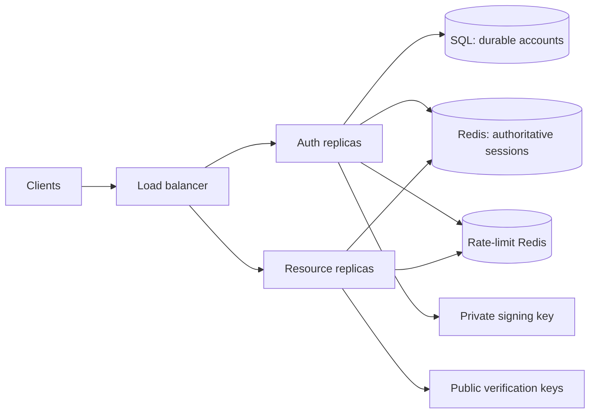

# Scaling and resilience review

This records the baseline review and the implementation that followed it. The implementation has not yet been load-tested against a Redis HA deployment.

## Confirmed requirements

- Approximately one million registered users and 10,000 simultaneous users. Whether this means active sessions or concurrent HTTP requests, plus peak RPS and latency objectives, remains open.
- Redis unavailable: reject protected requests. Logout takes effect immediately when Redis confirms the delete.
- Losing session state may force users to authenticate again.
- Client types and refresh retry behavior remain unspecified. The current behavior intentionally requires sign-in after an ambiguous refresh retry.

## Findings and implementation

1. **P1: two revocation authorities could lose logout.** The baseline revoked SQL first and then added a Redis deny marker; a missing marker was accepted. The isolated fault-injection check reproduced acceptance after SQL revoke and Redis marker loss. **Implemented:** Redis now owns the active session record. Every protected request requires it; logout deletes it and only acknowledges success after Redis confirms. There is no SQL fallback.
2. **P2: post-rotation failures could consume a credential.** The baseline rotated SQL state before reading the user and signing. The injected user-read failure followed by a retry reproduced family revocation. **Implemented:** account lookup and token signing happen before Redis rotation. Rotation is a single Lua compare/update. Replaying any valid older generation revokes the session. A dropped successful refresh response can still require sign-in, by the selected contract.
3. **P1: dependency work was not bounded.** **Implemented:** Redis has an 800 ms command timeout, no offline queue, no automatic command replay, and a configurable per-process in-flight cap; SQL has bounded pool acquisition and request timeouts; Fastify has a handler timeout; Argon2 has a per-process concurrency cap with immediate overload rejection. Session, rate-limit, and M2M replay Redis commands use short circuit breakers. These are initial values, not load-tested targets.
4. **P2: health probes depended on Redis rate limiting.** **Implemented:** liveness has no dependency check, readiness checks both Redis stores and SQL when used, and both routes bypass rate limiting.
5. **P2: SQL refresh history grew without cleanup.** **Implemented:** session state and the current refresh verifier/generation live in one expiring Redis record; no per-rotation history is stored. New schema no longer creates SQL session tables. The legacy session/history tables were dropped from the local SQL Server database after confirming their foreign keys; `Users` remains.
6. **P2: login hashing had no bulkhead.** **Implemented:** each process admits at most `PASSWORD_HASH_CONCURRENCY` Argon2 verifications and rejects excess work with 503. Global IP/account/device policy still needs production-specific tuning.
7. **P2: infrastructure errors looked like bad credentials.** **Implemented:** invalid tokens return 401; Redis and SQL failures return 503 and protected requests remain closed.
8. **P2: key and role lifecycle needed definition.** **Implemented:** JWTs use `kid` and a configurable public-key map for overlap during rotation. Existing access-token role claims remain valid for their five-minute lifetime after account/role changes; faster revocation needs a separate role-version consistency decision.

## Implemented runtime shape

`API_ROLE=auth` opens SQL and has the signing key. `API_ROLE=resource` uses Redis and public verification keys only. `API_ROLE=all` is for local development. Optional Redis Cluster startup nodes are supported; session scripts use one key per operation. The details and deployment guidance are in [scaling-architecture.md](../scaling-architecture.md).

## Redis loss and failover

Missing or expired session state denies access and requires sign-in. Redis asynchronous replication can nevertheless restore stale state after losing an acknowledged logout or rotation. When rollback is uncertain, the [recovery procedure](../operations/session-redis-recovery.md) requires closing traffic, draining every old replica, changing `SESSION_NAMESPACE`, and reopening only after all new replicas are ready. This is an operational fence; ordinary Redis failover alone does not prove strict revocation.

Session Redis uses `noeviction`; disposable rate-limit counters use a separate Redis endpoint. Capacity still needs measurement using expected retained sessions, devices, and peak requests. One million registered accounts and 10,000 concurrent users do not define those workloads by themselves.

## Remaining decisions

1. Does 10,000 simultaneous mean signed-in users, open connections, or HTTP requests executing at once? What are peak API RPS, login RPS, and p95/p99 goals?
2. Are clients browser, native mobile, backend services, or a mixture? This determines refresh coordination and feasible sender binding.
3. Is reauthentication after a lost refresh response acceptable? The implementation currently says yes.
4. How quickly must account disable or admin-role removal invalidate access tokens? Current maximum is the access token's five-minute lifetime.

## Technical references

- [OAuth security BCP: refresh-token replay and rotation](https://www.rfc-editor.org/rfc/rfc9700.html#section-4.14)
- [Redis replication and acknowledged-write loss](https://redis.io/docs/latest/operate/oss_and_stack/management/replication/)
- [Redis atomic scripting and blocking behavior](https://redis.io/docs/latest/develop/programmability/eval-intro/)
- [Redis persistence tradeoffs](https://redis.io/docs/latest/operate/oss_and_stack/management/persistence/)
- [ioredis queue and timeout options](https://github.com/redis/ioredis/blob/main/lib/redis/RedisOptions.ts)
- [Fastify timeout semantics](https://fastify.dev/docs/latest/Reference/Server/)
- [Node event-loop and worker-pool capacity](https://nodejs.org/learn/asynchronous-work/dont-block-the-event-loop)
- [Reliability patterns: bulkheads and circuit breakers](https://learn.microsoft.com/en-us/azure/architecture/framework/resiliency/reliability-patterns)
