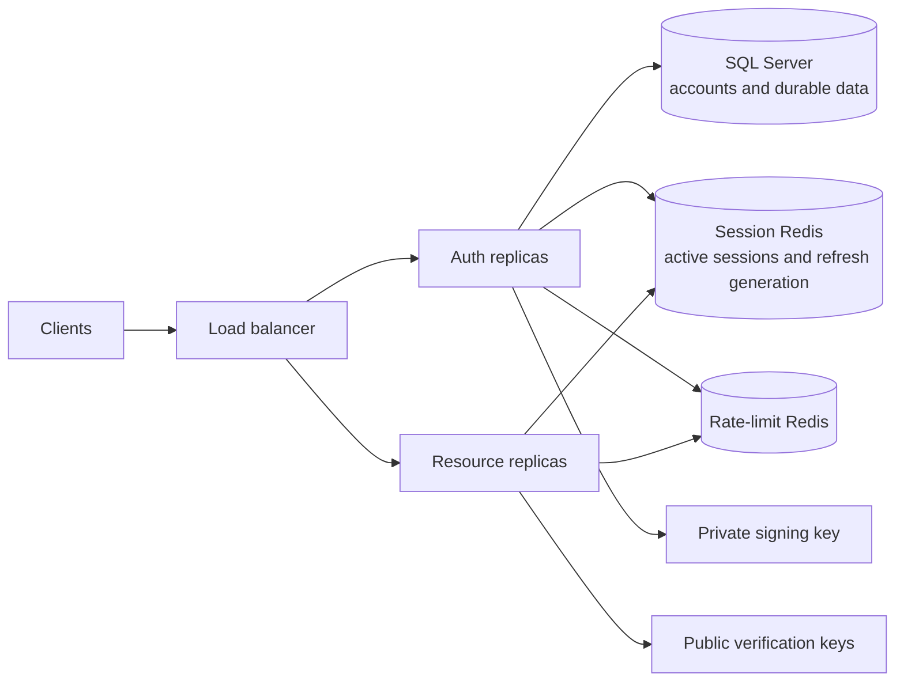

# Aquila scaling direction

Aquila keeps durable user data in SQL Server and puts live sessions in Redis. The same codebase has three startup modes: `all` for local development, `auth` for login/token issuance, and `resource` for protected application traffic.

## Runtime shape



Auth replicas need the SQL pool and private signing key. Resource replicas need only Redis and public verification keys. Protected resource requests do not call SQL. Redis is authoritative: a missing session denies access and is never reloaded from SQL. For Redis Cluster, configure comma-separated startup nodes with `REDIS_CLUSTER_NODES` and `RATE_LIMIT_REDIS_CLUSTER_NODES`; each session, replay, and rate-limit Lua operation uses one key, so it routes to one slot without cross-slot transactions. Use a `rediss://` URL to enable TLS for cluster nodes.

## Request work

```text
Protected user request: verify EdDSA access JWT -> one Redis session lookup -> handler
Login: SQL account read -> bounded Argon2id verify -> sign tokens -> create Redis session -> publish issued-token proof -> wait for consumer apply
Refresh: verify refresh JWT -> Redis session read -> SQL active-account read -> sign -> atomic Redis rotation -> publish issued-token proof -> wait for consumer apply
Logout: durable revocation event -> wait for consumer projection acknowledgement -> Redis delete -> acknowledge
```

Refresh JWTs use a distinct `typ` and `token_use`, a random 256-bit `jti`, and a signed generation number. Redis stores only the current `jti` hash. One atomic Lua transition advances the generation; a cryptographically valid token from an older generation revokes that session. No per-refresh history grows in SQL or Redis. A refresh response lost after rotation can require sign-in again; retrying the old token is treated as replay.

SQL connections are opened only by `all` and `auth` roles. `SQL_POOL_MAX` defaults to 10 per auth process, so capacity still depends on auth replica count and SQL Server limits. SQL requests, pool acquisition, Redis commands, and full Fastify handlers have bounded timeouts. Password hashing admits at most `PASSWORD_HASH_CONCURRENCY` operations per process. Redis session and limiter gates admit at most `REDIS_MAX_INFLIGHT` commands per process, with no waiting queue. Both reject excess work with 503 instead of accumulating unbounded work.

## Session storage and capacity

Redis session keys expire at the earlier of the idle refresh expiry and absolute session expiry. Capacity planning must count all retained sessions and devices during the idle window, not only users currently sending requests. Measure real key memory with representative sessions; 1,000,000 registered users does not imply 1,000,000 live sessions, but a long idle TTL can retain a substantial fraction of them.

Session Redis uses `noeviction` so memory pressure cannot silently evict authorization state. Session creation fails closed if Redis is full. Rate-limit counters use a separate Redis endpoint and memory budget, so abusive request counters cannot consume session capacity. Production should use managed Redis sized for observed session count and peak auth lookup rate; the local Compose instances are development settings, not a production capacity claim.

## Failure behavior

- Redis unavailable or command deadline exceeded: protected requests, login session creation, refresh, and logout fail closed with 503. There is no SQL or process-memory fallback.
- Session-event broker or consumer projection unavailable: token issuance, early session invalidation, and logout return 503. Successful login/refresh and logout wait for the consumer's applied acknowledgement.
- Session absent or expired: 401 and reauthentication. Logout returns success only after Redis deletion succeeds.
- SQL unavailable: login and refresh return 503; existing protected requests continue through Redis without SQL.
- Redis command failures open a short per-process circuit after three failures. The circuit returns 503, then allows one bounded probe after one second.
- Liveness does not depend on Redis or SQL. Readiness checks session Redis, rate-limit Redis, and SQL on auth roles. Health routes are exempt from rate limiting.
- Refresh network ambiguity may force reauthentication. No automatic retry is applied to refresh mutations.

Redis uses asynchronous replication in common HA deployments. A failover or restore can roll back an acknowledged logout or rotation. If state loss or rollback is uncertain, use the [session Redis recovery procedure](operations/session-redis-recovery.md): drain every auth/resource replica, change `SESSION_NAMESPACE`, start all replicas on the new namespace, verify readiness, then reopen traffic. All existing users sign in again. Do not reopen traffic while any old namespace replica is serving.

## Key rotation and authorization updates

`JWT_SIGNING_KEY_ID` selects the private key's `kid`. `JWT_VERIFY_KEYS_JSON` maps accepted key IDs to public PEM files and may contain old and new keys during a rotation. Deploy verifiers with both public keys before switching the signer. Keep old public keys until every access token and refresh session signed with them has expired or been revoked; with the default session lifetime, that can be 30 days. Private keys belong only on auth replicas.

Access JWTs carry roles for five minutes. Disabling a user or changing roles does not change an already issued access JWT immediately; refresh checks the current SQL account and stops disabled users from receiving new tokens. If admin-role removal must take effect faster than the access-token lifetime, add a role-version check with a deliberately chosen consistency/capacity cost.

## Patterns in use

| Pattern | Aquila use |
| --- | --- |
| Factory | `createContainer()` constructs role-specific clients and services; `createApp()` registers the role's HTTP surface. |
| Repository | `IUserRepository` and `ISessionRepository` separate SQL account reads and Redis live sessions from application code. |
| Middleware pipeline | Helmet, cookies, distributed rate limits, origin checks, JWT verification, then Redis session authorization. |
| Dependency injection | `src/config/container.ts` owns shared process resources; `identity.container.ts` and `m2m.container.ts` compose feature adapters and services. |
| Command | Login, refresh, logout, and M2M token issue are explicit operations. |
| Circuit breaker | Redis command gates protect session, rate-limit, and M2M replay operations; failures remain closed and return 503. |
| Layer boundaries | `src/routes`, `src/controller`, `src/services`, `src/interfaces`, `src/repositories`, and `src/clients` separate HTTP, behavior, contracts, and external systems. |
| Async wrapper / Proxy | Not added: Fastify already handles async route errors, and there is no downstream business API client to wrap. |
| Durable event stream | NATS JetStream carries session activation/issued-token proofs and revocations. Aquila waits for a consumer-applied acknowledgement; Core NATS replies alone are not the event record. |

## Deployment steps

1. Start independent auth and resource deployments from the same image; route `/v1/auth/*` and `/v1/m2m/token` to auth, and protected resource paths to resource.
2. Keep SQL credentials and private JWT keys out of the resource deployment.
3. Load-test with expected in-flight requests, API RPS, login RPS, session count, device count, and refresh behavior. Track p95/p99, Argon2 saturation, SQL pool wait, Redis latency, memory, rejected commands, and 503 rate.
4. Size Redis from measured retained session count and memory. Use a separate HA deployment for sessions and disposable rate-limit counters.
5. Decide whether five-minute role revocation and reauthentication after an ambiguous refresh response meet product requirements.
